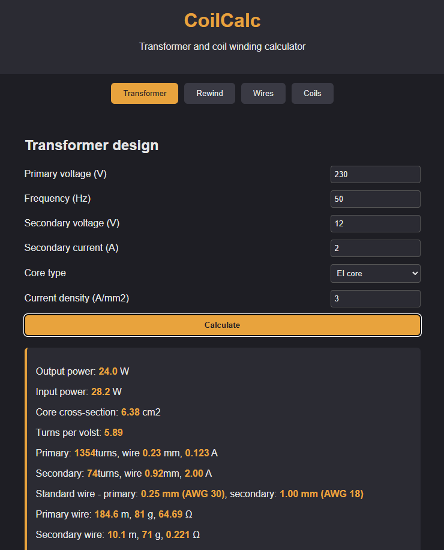
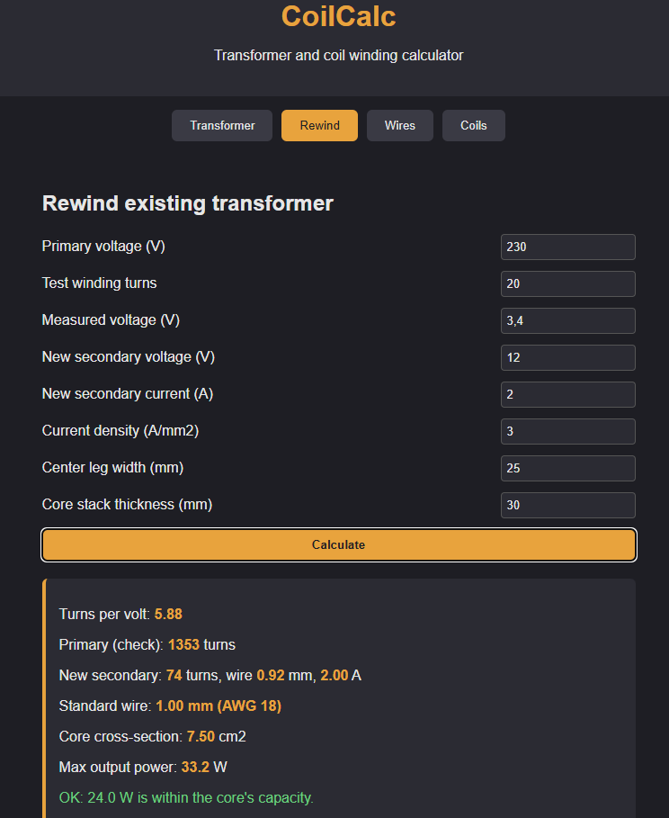
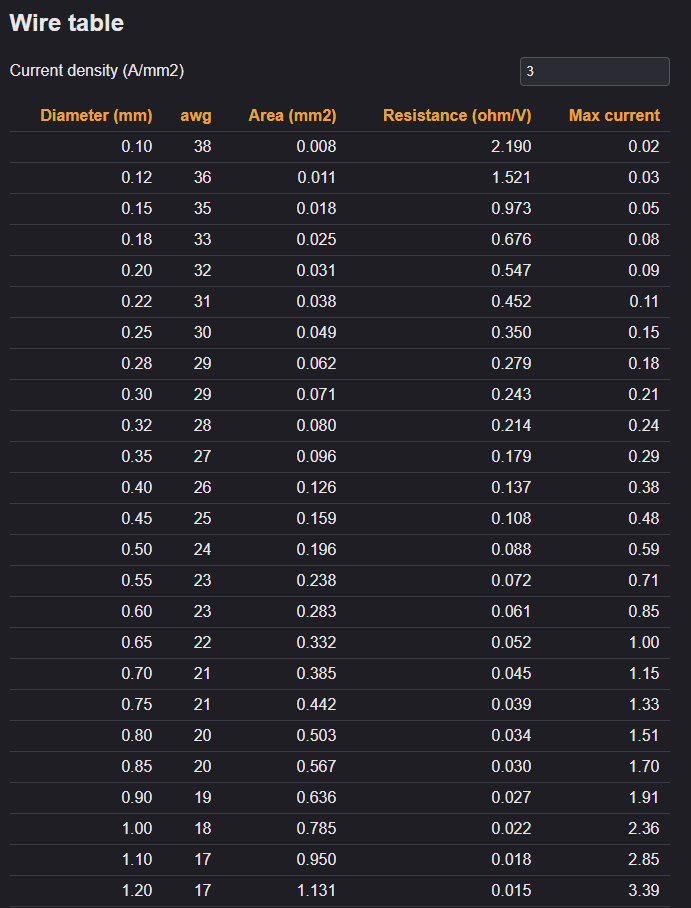
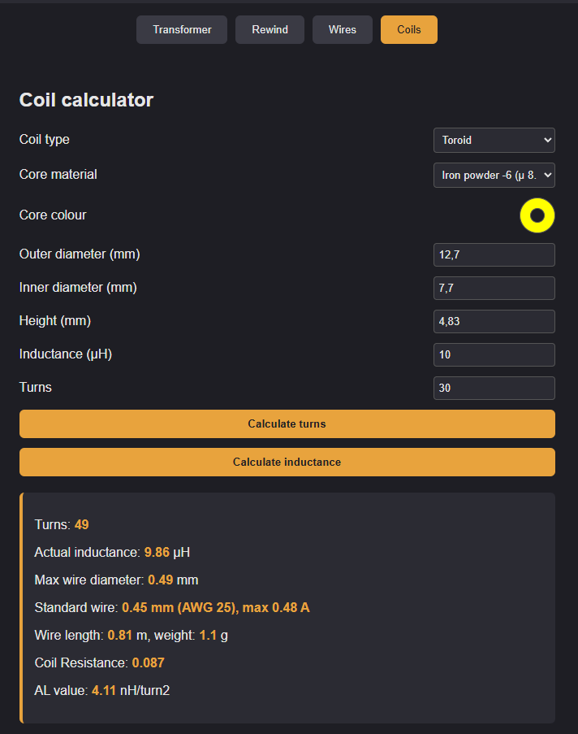

# Coil Calculator
A web tool for electronics hobbyists that helps you design and rewind transformers and coils. It calculate the number of turns, the wire you need, and the power lost as heat in the windings. It's usefull when you want to build your own power supply, give an old transformer a new output voltage, or wind a coil for a filter or a crossover, without doing all the maths on paper.
## Usage

The first tab is Transformer, which is used for designing a new transformer. You enter the input and output voltage, the current, the frequency, the core type and the current density. The calculator then shows the core cross-section you need, the number of turns for both windings and the wire diameter the transformer should be wound with. It also shows how many metres of wire will be used, how much it weighs, what its resistance will be, how much power is lost as heat and how much the output voltage drops under full load.

The second tab is Rewind, which is used for giving an old transformer a new output voltage. You take off the secondary winding, wind a few test turns on the core, then measure the AC voltage on the test winding and enter the values into the calculator (this lets the program figure out how many turns per volt the core needs). You also enter the primary voltage, the output voltage and current you want, and the current density. The calculator then shows how many turns the new secondary needs and what wire diameter to use, along with the nearest standard wire you can buy. It also shows the primary turns, so you can check that your measurement makes sence. If you enter the width of the core's centre leg and the thickness of the stack, it calculates the maximum power the core can handle and warns you if the output you want is too much.

The third tab is Wires, a table of standard copper wires from 0.10 to 2.50 mm. For each wire it shows the AWG size, cross-section, resistance per metre and the maximum current, which updates when you change the current density.

The fourth tab is Coils, for air-core coils and toroids. for an air-core coil you enter its diameter and length, for a toroid you pick the core material (powdered iron or ferrite, with a colour preview) and enter the core dimensions. You can calculate the turns from the inductance or the inductance from the turns. It also shows the AL value, the thickest wire that fits in a single layer, and the wire length, weight and resistance.

## How to run 
### Hosted instance
- [Link!](https://kylda-007.github.io/CoilCalc)
### Local hosting
Clone the repository. Open `index.html` in your browser or set up a static web server
